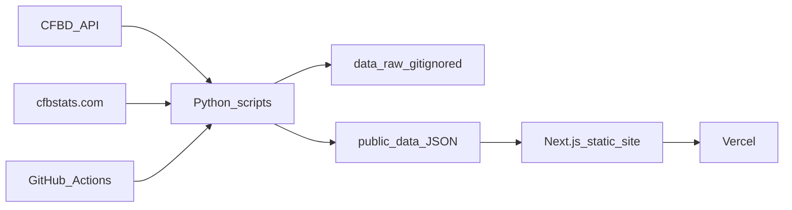

# 2fans1pod Phase 1

Status: plan saved. The website code has not been started.

This file is the product plan. The living notes next to it are:

- [task.md](task.md) — the ordered to-do list. Check items off as we finish them.
- [memory/README.md](memory/README.md) — how this memory system works.
- [memory/decisions.md](memory/decisions.md) — choices we already made.
- [memory/open-questions.md](memory/open-questions.md) — questions still to ask.
- [memory/log.md](memory/log.md) — a short diary of what we did each session.
- [AGENTS.md](AGENTS.md) — the note future coding sessions should read first.

When the plan changes, edit this file and add a line to `memory/log.md`. When a choice is settled, move it from `memory/open-questions.md` to `memory/decisions.md`.

The old site at [github.com/Ghaziszn/2fans1pod-website](https://github.com/Ghaziszn/2fans1pod-website) stays as a reference for which stats to pull. We rebuild it in the new stack. We do not port the VSIN betting-splits scraper.

After you approve this, we go one step at a time and pause to explain: GitHub repo and ignore rules, then the Next.js shell and first Vercel deploy, then the first data script, then the features. You will always know what a new file is for before we add the next one.

## What you are building

A static website. “Static” means the pages are files generated ahead of time. Visitors’ browsers do the interactive work (picking winners, dragging rankings, comparing teams). There is no server and no database. Vercel’s free Hobby plan hosts the files. GitHub Actions (also free) runs the Python data scripts on a schedule and commits updated JSON, which makes Vercel republish the site.



## Decisions locked in

- **The homepage is a rest-of-season what-if, not a picture of today’s bracket.** Every remaining regular-season game has a winner in the scenario. The ones you have not touched go to the higher-ranked team. The bracket, the ranking, and a one-sentence “who’s in / who’s out” answer all update as soon as you change a result. You can still drag the rankings to play committee, and you can still tap winners through the national championship. Details are in “Rest-of-season simulator” below.
- **Teams the committee has not ranked** sit under the top 25, ordered by CFBD Elo (a free win/loss strength rating from the same API). The page says this in the “how rankings are adjusted” note.
- **Contact form:** [Web3Forms](https://web3forms.com) free tier (about 250 messages a month). A hidden honeypot field catches bots. Formspree (about 50 a month) is a later swap if you outgrow it; the form is one component, so changing services does not touch the rest of the site. The form access key is public by nature on a static site. The CFBD API key never is.
- **New public GitHub repo** named `2fans1pod` under your account. Public is what lets GitHub’s free plan use branch protection. The old Flask repo is not reused. Phase 1 data is already public (schedules, stats, rankings).
- **Logo** is copied from the old repo (`static/images/2fans1pod_logo.jpg`). Before any page is styled, we look at it together and set one accent color in config. Header and footer stay neutral. Team colors from CFBD appear only on team rows, bracket chips, and comparison bars, as a stripe or bar, so yellow-on-white text never happens.
- **Site URL** starts as the free Vercel address. One field in config holds it, so a custom domain later updates canonical links, the sitemap, and share cards in one place.
- **No analytics in Phase 1.** We can add a privacy-friendly tracker later if you want one.

## Official 2026-27 rule you did not write down

The [CFP’s own 12-team page](https://collegefootballplayoff.com/sports/2024/5/29/12-team-format) matches your bids, byes, home first round, and no re-seeding. It adds one seeding rule: an automatic qualifier ranked outside the top 12 is placed at the bottom of the seeds, still in rank order relative to other outsiders. An at-large team ranked 13 can therefore be seeded above a conference champion ranked 18. This ships turned on, in [config/cfp-format.json](config/cfp-format.json), so you can switch it off without touching code.

Also stored there, because the format will change again:

- 4 automatic bids: ACC, Big Ten, Big 12, SEC champions.
- 1 automatic bid: the single highest-ranked team from the American, Conference USA, MAC, Mountain West, Pac-12, or Sun Belt, even if that team did not win its conference.
- Notre Dame is automatic only if ranked in the top 12. That uses up a spot, so at-large bids drop from 7 to 6. UConn is the other independent and does not get Notre Dame’s rule.
- Seeds 1–4 bye. First round is 5v12, 6v11, 7v10, 8v9 at the higher seed’s home stadium.
- Quarterfinals stay fixed: 1 vs 8/9, 2 vs 7/10, 3 vs 6/11, 4 vs 5/12. No re-seeding.
- Bowl-site selection (seeds 1–4 picking Fiesta, Cotton, Peach, Rose) is described on the page in one sentence and not built. The bracket shows the pairing, not a bowl picker.

2026 has 138 FBS teams and 10 conferences plus Notre Dame and UConn. Membership comes from the CFBD feed each run, so realignment is not hard-coded. Pac-12 football in 2026 is the rebuilt 8-team league and is in the Group of Six bid group.

## Ranking rule, written so it can be explained on the page

Knobs live in [config/ranking.json](config/ranking.json), separate from the official format, because you will replace this formula later.

Starting order: CFP 1–25, then every other FBS team by Elo. Ties in Elo keep a stable alphabetical order.

Every scenario is applied in one pass from the starting order. The simulator does not re-rank after each game and then re-pick favorites, which would loop. Games already played are locked. Games against FCS teams are included. If you leave an FCS game alone, the FBS team wins. If you give the win to the FCS team, it counts as a loss. An FCS opponent is not in the ranking list, so there is no “drop below them,” but the spot penalty still applies. Changing one chip reruns this same one-pass math immediately.

For each team:

- `score = startingRank + (future losses × lossDropSpots)`
- `lossDropSpots` defaults to **4**.
- If they lost to a team that started ranked worse, `score` becomes at least that opponent’s starting rank + 1. Losing to two worse teams puts them behind the worse of the two.
- Sort by score. Equal scores keep the starting order.
- `championRankBoost` defaults to **0**, so winning a conference does not move a team by itself until you set a number.

The conference champion follows the scenario. Regular-season picks are applied first. If the championship game is already on the schedule, it is a chip and its winner is the champion. If it is not scheduled yet, the simulator adds a projected championship between the top two teams in that scenario’s conference standings. Ties for those two spots use the higher rank, and the page says it is a projection. Wins out includes that game when the team is one of the two participants. If winning the rest of the scheduled games still leaves them outside the top two, Wins out does not hand them a title. The projected game is one shared chip, so both teams cannot win it. The real championship game replaces the projection as soon as it is published. If more than two teams are tied at the top, the page says so and asks you to pick who plays and who wins. We still do not code official tiebreaker rules. Until you break a tie, the higher-ranked tied team is used so the bracket can still draw, and the tie is labeled.

Dragging the list marks it “ordered by you.” The formula stops moving those rows until you hit “Reset to formula.” Manual order is included in the share link. A Simulate control replays the shuffle animation; it is not a gate. The bracket is already showing the scenario.

Before the first CFP poll of a future August, the same page runs on Elo only and says so. It does not pretend those are committee ranks.

## Rest-of-season simulator

The question the page answers is: “If the rest of the season goes this way, who is in, and what does the bracket look like?” On load during the season, that way is “favorites win.” After the real field is set in December, the site opens on the official bracket instead, and what-if picks still work on top of it. Give Alabama one loss and Georgia one loss and the bracket moves. Give Wake Forest a win in every remaining game and you can see whether BYU or Texas is the team that falls out.

A ranked-only board cannot do that. Wake Forest’s path to the ACC bid is interesting precisely when Wake is outside the top 25. A hard top-5-per-conference cap has the same hole: a team sitting 6th or 7th who can still win the league never appears. The default list is whoever can still change the field. Every other game stays one tap away, so any remaining outcome can be set.

**Who is on the board by default**

A team is a contender when any of these are true:

- They are in the CFP top 25, or in the extended top 30 (the bubble just outside the poll, including Notre Dame).
- They can still tie or pass their conference leader in conference wins, given games left. That is “still alive” for the automatic bid. In November this list is short. In September almost everyone is alive, so each Power conference shows at most 8 teams (best conference record first) and a row that says “N more still alive” opens the rest.
- They are in the Group of Six bid race: the leader of each of those six conferences, plus anyone in that conference who can still catch the leader. Same cap, 5 teams per conference, then an expander.

Power conferences and the Group of Six are separate sections, plus an Independents row for Notre Dame. Team colors are a stripe on the row.

**How you pick results**

Each contender row shows that team’s remaining opponents as large chips, including the projected championship when that team is in the top two. Tap a chip to flip the winner. “Wins out” sets every one of that team’s remaining scheduled games to a win, and wins the projected championship if they are one of the two teams in it. A game between two contenders is a single shared chip, so both sides cannot win it. Alabama “drops one” is: tap the one opponent who beats them, or tap Wins out and then flip one chip.

Under that, a collapsed section, “Every other game,” lists the rest of the FBS schedule by week. Favorites win those until you open it and flip one. That is the full schedule, including FCS opponents, without making the first screen a wall of games.

**What updates**

The moment a chip changes, three things move together:

- The projected ranking, using the one-pass rule above.
- A sentence under the title, in plain language. Example shape: “Wake Forest wins the ACC and is the 10 seed. Texas is the first team out. BYU is the 9 seed.”
- An In / Out strip: the 12 teams in the field, each with a short reason (SEC champion, at-large, Group of Six bid, Notre Dame), and the next 5 teams out. This is the direct answer to “does BYU or Texas make it over Wake?” The bracket below is the same field, seeded, with byes and the rounds you can play out.

On a phone the order is: the sentence, the In / Out strip, the contender chips, then the bracket. From about `1100px`, the scenario sits on the left and the bracket stays in view on the right.

Playoff games still default to the better seed. Tapping a playoff winner advances them. Changing an earlier playoff game clears later picks that no longer fit. Those picks are part of the share link.

## Share links

Homepage: `/?s=` plus a compact code of only your overrides (game flips, champion flips, manual order, playoff flips). A full 138-team order is a few hundred characters, under browser limits. Opening the link reproduces the bracket. No account, no database.

The browser also remembers the last scenario on that device. A shared link wins over that memory.

Matchups: `/matchup/alabama-vs-georgia` keeps the left/right order you picked.

Clicking any remaining game, or any playoff game, opens that pair in the calculator.

## Matchup calculator

Same categories as your old `static/js/app.js`, which already matches your list. Ranks are computed in Python and saved in JSON. The browser only displays them.

Each row shows the raw value, the national rank among FBS teams, and which side has the edge (better rank; a tie is neither). A count of edges sits at the top. Two stacked views:

- Each team’s own offense, and each team’s own defense, side by side.
- When Team A has the ball: A’s offensive rank in that category against B’s defensive rank, and the reverse.

A small Recharts diverging bar shows the rank gaps. One chart, not a wall of charts.

ATS record comes from CFBD `/teams/ats`, ranked by cover percentage. The consensus spread is shown only when these two teams are scheduled to play each other. Otherwise the row says no line is posted. Phase 4 adds our own model line on that same row. It is not part of this build.

Red zone scoring percentage (offense and opponent) is scraped from cfbstats.com on the schedule, cached, and rate-limited. If a scrape fails, last week’s red-zone file is kept and merged. The job fails rather than committing an empty file.

**Strength of schedule (v1), documented on the page and in the script header:** average winning percentage of FBS opponents, using only games already played. Each FCS opponent counts as a .400 win percentage so a cupcake does not look like a zero and is not dropped. Higher is a harder schedule. This is record-based SOS, not an SP+ opponent adjustment. National rank is precomputed with everything else.

## Design system

Two font families, self-hosted so they do not jump on load and do not depend on Google at view time:

- **Barlow Condensed** for headlines, seeds, and big numbers.
- **IBM Plex Sans** for everything else. Stat columns use its tabular figures so digits line up.

Light and dark colors are CSS variables. Light background is warm paper (`#f4f2ec`), not stark white. Dark background is off-black (`#0e0f12`). Text, muted text, and hairline borders have matching pairs. `next-themes` follows the device setting until the visitor toggles, then remembers the choice. No flash of the wrong theme.

Spacing is a 4px scale. Page gutters grow with the screen (`16px` up to `40px`). The simulator stops stretching at `1440px` and stays centered on ultrawide monitors. The contact page text column stays near `720px`. Tap targets are at least `44px`.

Motion is 150–220ms: ranking rows reshuffle, teams slide into bracket slots, stat bars grow. If the device asks for reduced motion, those animations are instant. Hover states are subtle and have a tap equivalent.

Helper icons are buttons, not hover-only tooltips. Tap, click, or keyboard opens a small popover. Escape or a tap outside closes it. Copy for each stat lives in [config/stat-catalog.json](config/stat-catalog.json).

The homepage is this scenario board. The title is “Playoff Simulator,” with the live one-sentence result under it. There is no marketing hero. The phone bracket is a vertical list of rounds (bye cards, then each game as a card). It is not a desktop tree shrunk to fit.

Header on every page: logo and “2fans1pod” (both go home), nav (Simulator, Matchup, Rankings, Conferences, Contact), search, light/dark toggle. Under `768px` the nav becomes a full-screen list. Search on a phone is an icon that opens the same overlay. Cmd/Ctrl+K opens it on a keyboard.

Footer: social rows from [config/site.json](config/site.json) (placeholder URLs you will replace), a short nav, data credit to CollegeFootballData.com and cfbstats.com, and one line that lines and ATS records are informational.

## Folder map

```
app/                     pages and the shared header/footer
  page.tsx               homepage = playoff simulator
  matchup/[slug]/        calculator, pretty URL
  teams/[slug]/          one page per FBS team
  conferences/[slug]/    standings and team list
  rankings/              this week's CFP rankings
  contact/
components/
  layout/                header, footer, search, theme toggle
  simulator/             contender rows, game chips, in/out strip, ranking list, bracket
  matchup/               comparison rows and the chart
  info/                  the tap-to-open help icon
lib/
  cfp/                   pure functions: adjust, select, seed, share code
components/ui/           shadcn pieces we actually use
config/                  hand-written settings scripts must never overwrite
  site.json              season year, site URL, social links, accent color
  cfp-format.json        official 2026-27 bids, seeds, pairings
  ranking.json           lossDropSpots and related knobs
  stat-catalog.json      labels, help text, which direction is "better"
  rivalries.json         matchups we prebuild for Google
  aliases.json           extra search names: bama, ole miss, and so on
public/data/             display-ready JSON the site ships with
  season.json            when it was updated, which week, which poll
  teams.json             names, slugs, colors, logos, conference
  conferences.json
  games.json
  rankings.json          committee top 25 plus the Elo tail
  team-stats.json        values and national ranks
content/news/            empty on purpose, for Phase 3 bot pull requests
scripts/                 Python fetchers, SOS, ranks, validator
schemas/                 the shape those JSON files must have
data/raw/                gitignored API dumps
.github/workflows/       the scheduled data job
.github/CODEOWNERS       later, news PRs are the only bot path
```

[public/data/](public/data/) is hard stats from scripts. [content/news/](content/news/) is the only folder a future Grok bot will be allowed to change, and only by pull request. Scripts are not allowed to write `config/` or `content/news/`.

## Search

A Python step writes `public/data/search-index.json` with teams (school, nickname, abbreviation, aliases), conferences, and the main pages. Fuse.js fuzzy-matches in the browser. “bama” can find Alabama, “ole” can find Ole Miss, “playoff” can find the simulator. Players and coaches are a later addition to the same index, not a new search system.

## Pages and SEO

Every page gets a unique title, meta description, and Open Graph / Twitter tags. One default share image uses the logo on the dark background. Per-team share pictures can wait; the text tags will not.

Readable URLs: `/teams/alabama`, `/conferences/sec`, `/rankings`, `/matchup/alabama-vs-georgia`, `/contact`.

Generated at build time:

- All 138 team pages: record, schedule, key stats with national ranks, and a playoff outlook (in the current field, automatic bid, or outside).
- Conference pages: standings and links to teams.
- “CFP Rankings This Week”: the committee top 25, the poll date, and the full order the simulator uses underneath.
- Rivalry matchup pages from the starter list in [memory/decisions.md](memory/decisions.md), stored in `config/rivalries.json` when we build, each with its own title and description. Adding or removing one later is an edit to that file.

Arbitrary pairs that are not in the rivalry list still work. A static export cannot invent infinite pages, so Vercel is told: if someone opens `/matchup/some-team-vs-other-team` and we did not prebuild it, serve the calculator shell and let the page read the names from the URL. Prebuilt rivalry pages stay real HTML for Google. Team, conference, and rankings pages are all real HTML.

`sitemap.xml` and `robots.txt` are generated by Next from the pages above. Structured data: `WebSite` on the home page, `SportsTeam` on team pages, `ItemList` on the rankings page, and `SportsEvent` on a matchup page only when those teams are actually scheduled to play.

Heading order is semantic (one `h1` per page). A skip-to-content link is first. Drag-and-drop has up/down buttons so a keyboard or a thumb can reorder without a precise drag.

## Data job and security

`.gitignore` is written before the first commit. It ignores `.env`, `.env.local`, `data/raw/`, `node_modules`, `.next`, `out`, `.venv`, and `__pycache__`. [.env.example](.env.example) lists `CFBD_API_KEY` and `WEB3FORMS_ACCESS_KEY` with empty values.

Python (3.12) in `scripts/`:

- Pull FBS teams (colors, logos), conferences, schedule, results, CFP rankings, season stats, Elo, ATS, and consensus lines.
- Download small logo files into `public/logos/` so pages do not depend on another site’s images at view time.
- Scrape red zone offense and opponent red zone from cfbstats.com for the season in `config/site.json`, about one request every 1.5 seconds.
- Compute SOS and every national rank.
- Validate against `schemas/` (required fields, team count in a sane FBS range, no empty files, ranks present).
- Exit with an error before any git commit if validation fails. The live site keeps yesterday’s JSON.

The GitHub Action runs daily at 14:00 UTC (morning US) and can be run by hand. It commits only when the JSON actually changed. The commit overwrites the files; git history is the archive. Raw responses stay in `data/raw/` and are never committed.

You will turn on a ruleset for `main`: pull request required, force-push blocked, and a bypass only for the GitHub Actions data bot. Humans and future news bots open pull requests. We will click through that GitHub setting together; it is not a code file.

## What Phase 1 deliberately leaves for later

Reserved, not built: advanced stats, multi-year recruiting, transfer portal, Coaching Power Index (your Excel file), the news feed, and your prediction model. The folder split above is what makes those safe to add. The old repo’s recruiting, portal, and coaching JSON are the source we will port in Phase 2.

## How we will check it

Logic tests (Vitest) for the field, the “outsider seeds sink” rule, Notre Dame’s effect on at-large spots, the loss-drop math, who counts as still alive, a “wins out” scenario that changes the champion and the last team in, and share-link round trips. A small Python test checks SOS on a fake four-team season and checks the validator rejects an empty file. The red-zone scraper is tested against a saved HTML fixture so tests do not hit cfbstats.com.

In the browser, on a running site: load the simulator and read the favorite-wins sentence. Tap Wins out for a team outside the top of the standings and confirm the sentence, the In / Out strip, and the bracket all move. Flip one loss for a contender. Open “Every other game” and flip a non-contender. Break a championship tie. Drag a team. Play a bracket game through to the title. Copy the share link and open it in a fresh tab. Open a rivalry matchup and a random pair. Use search with “bama” and with Cmd/Ctrl+K. Submit the contact form’s success and error states, and confirm the honeypot blocks a filled bot field. Repeat the simulator and calculator at a narrow phone width, a foldable unfolded width, a tablet, a laptop, and a wide desktop. Check light, dark, and reduced motion.